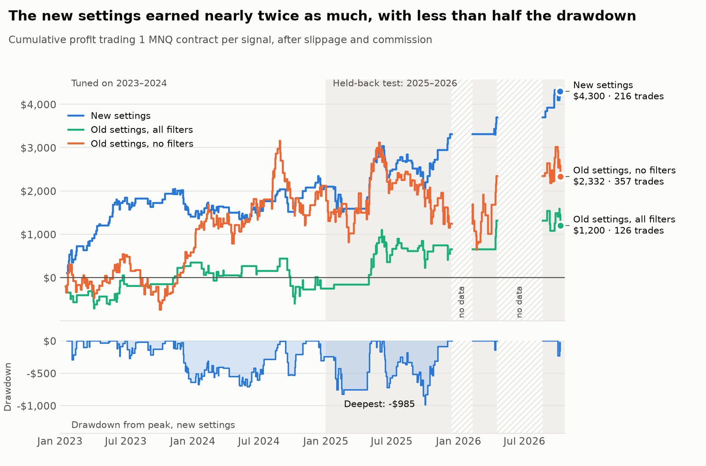
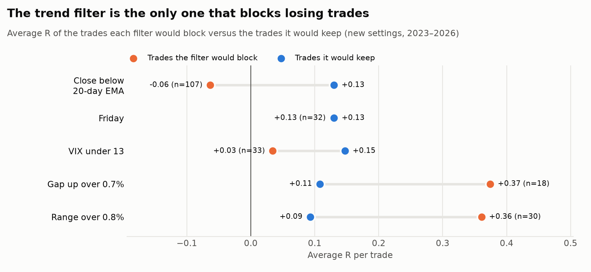
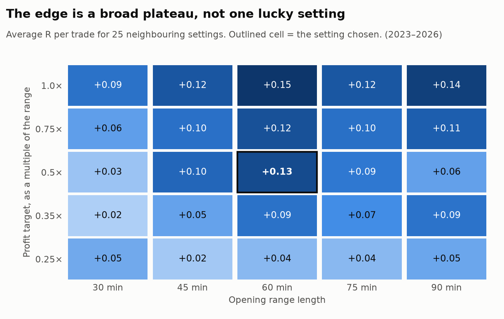
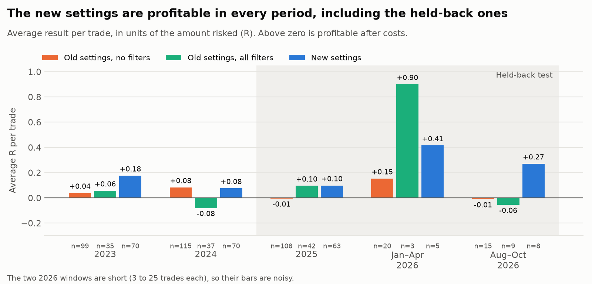
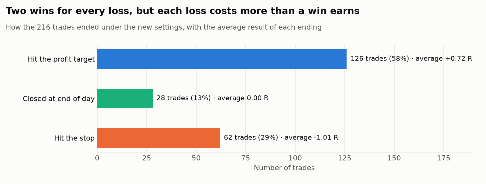
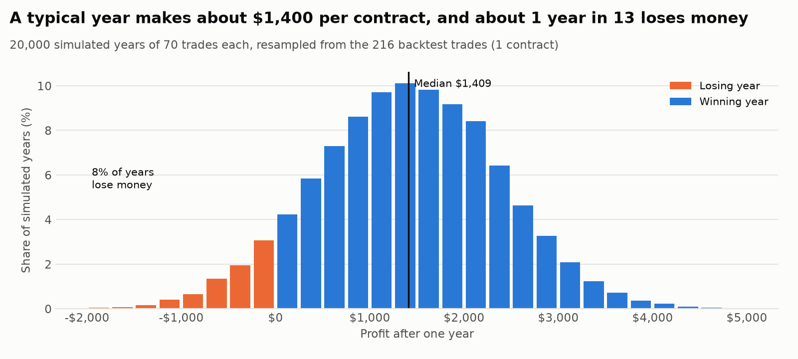
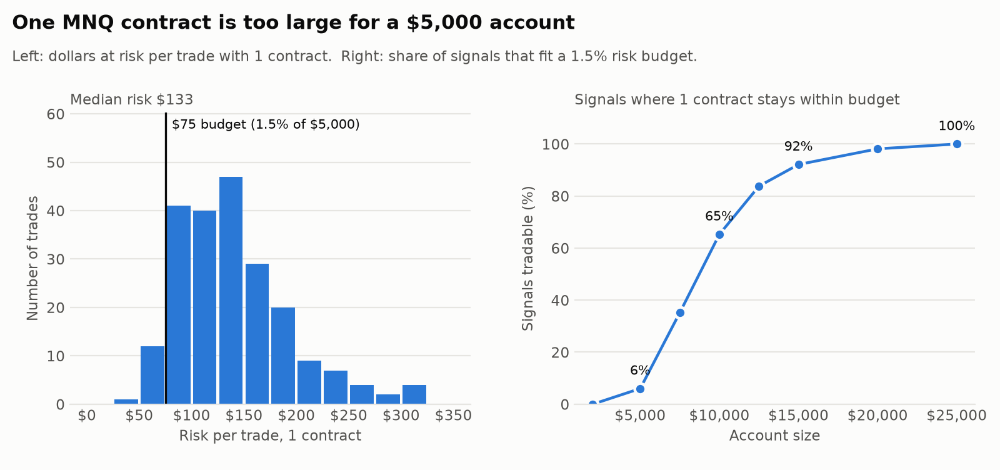

# ORB Bot Logbook

A running record of how this bot was built, tested and changed, including the parts that did not work. Entries are in date order. Every chart and table in the backtest entries can be regenerated with `python get_data.py` then `python make_charts.py`.

## Where things stand (2026-10-12)

- **The bot works end to end up to the order.** It connects, locks the opening range, detects a breakout and sends a bracket order. No order has filled yet, because the broker account has no futures permission (see the 2026-06-26 entry).
- **The strategy was retuned from a backtest of about 800 trading days.** The new settings are a 60-minute opening range, a stop at the range midpoint, a target of half the range, and one filter (price above its 20-day average).
- **The edge is real but small.** After costs the new settings average +0.13 R per trade (R is the amount risked), a 65% win rate and a profit factor of 1.48, and they were profitable in every period tested, including the two years held back from tuning.
- **Account size is the limiting factor.** One MNQ contract risks about $130 to $310 per trade. A 1.5% risk rule needs an account of roughly $15,000.
- **Next:** run the bot every weekday on free delayed data, with no broker, to build a forward track record.

| | Trades | Win rate | Avg R | Profit factor | Profit, 1 contract | Max drawdown |
|---|---|---|---|---|---|---|
| Old settings, no filters | 357 | 54% | +0.04 | 1.09 | $2,332 | $2,510 |
| Old settings, all filters | 126 | 53% | +0.04 | 1.15 | $1,200 | $1,039 |
| **New settings** | **216** | **65%** | **+0.13** | **1.48** | **$4,300** | **$985** |

<picture>
  <source media="(prefers-color-scheme: dark)" srcset="charts/equity-dark.png">
  
</picture>

---

## 2026-05-14 — First build

- Wrote the first version: a single Python file that connects to Interactive Brokers (IBKR) Trader Workstation, trades MNQ (Micro Nasdaq-100 futures, $2 per point), and logs each day to a CSV.
- Starting rules: 15-minute opening range, long only, target 1.5 times the range, stop at the range low.
- Applied for an IBKR account with futures permission. IBKR was chosen because it offers free paper trading with a Python API for futures.

## 2026-06-17 — Settings changed from published research

No backtest of my own yet. Every change in this entry came from published statistics and other people's backtests.

| Setting | Before | After | Reason given at the time |
|---|---|---|---|
| Opening range | 15 min | 30 min | Published NQ continuation rates favoured 30 minutes |
| Target | 1.5× range | 1.0× range | Median extension after a breakout was under 1× |
| Stop | Range low | Range midpoint | A third-party backtest showed a higher win rate |
| Risk per trade | 2% | 1.5% | Common professional ceiling |
| Loss limits | None | $150 a day, $300 a month | Prop-firm style limits |
| Filters | None | VIX 13 to 35, above 20-day EMA, gap under 0.7% | Each backed by a separate source |

The repository was made public the same day. The benchmark I set out to match was a 74.6% win rate from a third-party NQ backtest. The 2026-10-12 entry shows why that comparison was wrong.

## 2026-06-19 — Paper account and first bugs

- Paper account approved, Trader Workstation installed, API enabled on port 7497.
- **Bug: contract would not resolve.** The June contract had expired the day before and a generic MNQ request returned six candidates. Fixed by requesting contract details, dropping expired ones and taking the nearest expiry.
- **Bug: yfinance warnings.** A newer yfinance returned a different table shape. Fixed the conversions.

## 2026-06-25 — Paper log-only mode, and the first clean run

- **Problem:** the filters kept skipping every day, so the bot never placed a paper trade and there was nothing to learn from.
- **Change:** added `PAPER_LOG_ONLY`. In paper mode every filter writes the reason it would have skipped into a `would_skip` column and the bot trades anyway. Days with no breakout are still real no-trade days.
- Also added: ATR-based stop, a stop-to-breakeven move, an event-day calendar (`events.py`), a September size cut and an early close on FOMC days.
- **First clean end-to-end run.** The range was 1.76% wide, there was no breakout, and the bot logged a `no_breakout` row. This proved the connect, contract, range, polling and logging steps.

## 2026-06-26 — First breakout, rejected by the broker

The first normal-width day broke out and the order path ran for the first time.

- Range locked at 0.65% (high 29372.75, low 29182.00).
- At 10:10 a 5-minute close of 29443.00 triggered the breakout.
- The bot sent a bracket order: buy 1 MNQ, stop 29182, target 29563.50.
- IBKR rejected it. Neither rejection was a code bug.

| Error | Meaning | Cause |
|---|---|---|
| 460 | No trading permission | The paper account inherits permissions from the live account, which was open but unfunded, so futures were never enabled |
| 162 | No historical data | No CME real-time market data subscription for MNQ |

Still untested after this day: a fill, the breakeven move, the end-of-day close and the profit calculation.

## 2026-08-21 — Resumed on a new machine

- Reinstalled everything on a second computer and confirmed the code matched the repository.
- Confirmed the funding rule: IBKR requires $2,000 of net liquidation value before it will open any futures position. That is an account-level floor and is separate from the per-contract margin.
- Newer Trader Workstation builds replace the "localhost only" checkbox with a Trusted IP list. `127.0.0.1` has to be added there.

## 2026-10-12 — Decision: prove the strategy before funding anything

Funding an account only makes sense if the strategy has an edge, and I had never tested that myself. So the plan changed: backtest first, for free, then run on delayed data, and only then think about a funded account.

### First backtest: 49 days

A quick script on the 60 days of 5-minute data that yfinance keeps, with no trading costs.

| | Trades | Win rate | Profit | Max drawdown |
|---|---|---|---|---|
| No filters | 20 | 45% | +$1,058 | $492 |
| All filters | 10 | 40% | -$30 | $456 |

Two things stood out. The win rate was nowhere near 74.6%. And the average loss was $185 against a $75 risk budget, because the ATR stop was about 170 points wide ($339 per contract) and the bot always trades at least one contract. Twenty trades is far too few to tune anything on, so the next job was finding more data.

### More data

| Source | Instrument | Bars | Period | Trading days used |
|---|---|---|---|---|
| Kaggle `tgtanalytics/nq-futures-1min-bar-2022-2025` | NQ | 1-minute | Dec 2022 to Dec 2025 | 722 |
| GitHub `axb0306/cme-futures-ohlc` | MNQ | 1-minute | Jan to Apr 2026 | 46 |
| yfinance `NQ=F` | NQ | 5-minute | Aug to Oct 2026 | 35 |

Checks before trusting it: I worked out each file's timezone and bar labelling from where the volume peaks (the 9:30 open and the 16:00 close). The Kaggle file is Eastern time labelled by bar end. The GitHub file is UTC labelled by bar start. There are two stretches with no data (mid-Dec 2025 to early Feb 2026, and mid-Apr to mid-Aug 2026), shown hatched in the charts.

### Method

- **Engine:** `orb_engine.py` replays each day bar by bar using the same rules as `orb_bot.py`. `backtest.py` reads `config.py`, so the backtest always tests what the bot would actually do.
- **Costs:** 0.5 point of slippage on every market or stop fill, and $1.24 commission per contract per round trip.
- **Conservative fills:** if the stop and the target are both touched inside one bar, the stop is assumed to have been hit first.
- **No lookahead:** the EMA, ATR and VIX values used for a day come from the previous session.
- **Held-back test:** settings were tuned on 2023 and 2024 only. 2025 and 2026 were not looked at until the candidates were chosen.

### Finding 1: the old settings made almost nothing

Over 357 trades the bot as configured averaged +0.04 R after costs, with a $2,510 drawdown against $2,332 of profit. With all filters on it was no better per trade. It was also risking $170 to $360 per trade on average, depending on the year, against a $75 budget.

### Finding 2: the 74.6% benchmark was never comparable

That figure comes from a backtest using a 15-minute range, a target of half the range, a stop on the far side of the range capped at 50 points, and no trading costs. A small target and a wide stop give a high win rate by construction. Its average win was smaller than its average loss. This bot used a 30-minute range, a full-range target and an ATR stop, so its win rate could never have matched.

### Finding 3: the breakout signal is real, but small

Tested 672 combinations of range length, stop, target, breakeven and direction on 2023 to 2024. Only about 1% looked statistically meaningful, which is what chance alone would give. 82% were slightly positive, but those were bull-market years and the bot only buys.

The useful test was against a benchmark that buys every day at the end of the range, with the same stop and target, whether or not there is a breakout:

| Setup | Breakout entries (avg R) | Buy every day (avg R) |
|---|---|---|
| 30-minute range (the old bot) | +0.06 | +0.01 |
| 60-minute range | +0.09 | +0.05 |
| 5-minute range | +0.17 | -0.03 |

The breakout beat blind buying in every setup, so the signal carries information. Short trades added nothing, so the bot stays long only. Published work points the same way: an independent replication of the best-known ORB paper found about +0.13 R before costs on NQ and roughly zero after them.

### Finding 4: one filter helps, four do not

<picture>
  <source media="(prefers-color-scheme: dark)" srcset="charts/filters-dark.png">
  
</picture>

- **Trend filter (close above the 20-day EMA): keep.** The trades it blocks lose money on average (-0.06 R). It improved all three setups above, both in the tuning years and in the held-back years.
- **Gap and wide-range filters: remove.** The trades they block were the best ones (+0.37 R and +0.36 R).
- **Low-VIX filter: remove.** The blocked trades were weaker than average but still profitable.
- **Friday skip: remove.** No difference on these settings (+0.13 R either way), and the sign flipped between the tuning years and the held-back years.
- Requiring three closes above the EMA instead of one made no reliable difference, so it is now one.

### Finding 5: the edge is a plateau

<picture>
  <source media="(prefers-color-scheme: dark)" srcset="charts/robustness-dark.png">
  
</picture>

All 25 neighbouring settings are positive. Ranges of 45 to 75 minutes with targets of 0.5 to 1.0 times the range all land between +0.09 and +0.15 R. I chose 60 minutes and 0.5× from the middle of that area for its higher win rate and smaller drawdown, and did not tune further. The 60-minute, 1.0× cell scores slightly higher, but the difference is well inside the noise.

### The new settings

| Setting | Before | After |
|---|---|---|
| Opening range | 30 min | 60 min |
| Entry window | 10:00 to 11:00 | 10:30 to 12:00 |
| Stop | Entry minus 0.4 × ATR, floored at the range low | Range midpoint |
| Target | Range high + 1.0 × range | Range high + 0.5 × range |
| Breakeven move | At 75% of the way to target | Off |
| Filters enforced | EMA (3 days), VIX 13 to 35, gap, range, Friday | EMA (1 day), VIX above 35 |
| Monthly loss cap | Sum of losing trades | Net profit and loss |
| Oversized trades | Always trade 1 contract | Skip in live mode if 1 contract exceeds the budget |

### Results by period

<picture>
  <source media="(prefers-color-scheme: dark)" srcset="charts/periods-dark.png">
  
</picture>

| Period | Trades | Win rate | Avg R | Profit factor | Profit, 1 contract | Max drawdown |
|---|---|---|---|---|---|---|
| 2023 to 2024 (tuned on) | 140 | 66% | +0.13 | 1.42 | $2,099 | $703 |
| 2025 to 2026 (held back) | 76 | 63% | +0.14 | 1.57 | $2,201 | $985 |
| All | 216 | 65% | +0.13 | 1.48 | $4,300 | $985 |

Stress tests on the new settings:

| Test | Avg R |
|---|---|
| As tested (0.5 pt slippage) | +0.13 |
| Double slippage (1.0 pt) | +0.12 |
| Four times slippage (2.0 pt) | +0.09 |
| Bootstrap 95% range for the true average | +0.02 to +0.23 |

In the bootstrap, fewer than 1% of resamples had an average of zero or below.

### How the trades end

<picture>
  <source media="(prefers-color-scheme: dark)" srcset="charts/exits-dark.png">
  
</picture>

A win at the target earns about 0.7 R and a stop costs a full 1 R, so the strategy needs its roughly two-to-one win ratio to stay ahead. The longest losing streak in the data was six trades.

### What a year looks like

<picture>
  <source media="(prefers-color-scheme: dark)" srcset="charts/montecarlo-dark.png">
  
</picture>

Resampling the 216 trades into 20,000 simulated years of 70 trades: the median year makes about $1,400 per contract, about 8% of years lose money, and a drawdown of $1,300 is within the normal range.

### Finding 6: the account-size problem

<picture>
  <source media="(prefers-color-scheme: dark)" srcset="charts/risk-dark.png">
  
</picture>

One contract risks a median of $133 per trade over the whole period, and about $200 at 2026 price levels. With a 1.5% risk rule:

| Account size | Signals where 1 contract fits the budget |
|---|---|
| $5,000 | 6% |
| $10,000 | 65% |
| $15,000 | 92% |
| $25,000 | 100% |

At $5,000 the choices are to accept about 4% risk per trade, or not to trade MNQ with real money. In live mode the bot now skips trades that exceed the budget. In paper mode it trades one contract and records `over_risk`.

### Code changes made today

- `config.py`: new settings above; `FILTER_FRIDAY`, `FILTER_GAP`, `FILTER_RANGE` switches (off); `MAX_RISK_OVERSHOOT`.
- `orb_bot.py`:
  - Loss caps now use net profit and loss. Before, the cap summed losing trades and ignored wins, so one or two losses stopped the bot for the month.
  - EMA and ATR now use completed sessions only, matching the backtest.
  - The opening range is taken from bars timestamped inside the range window, where before it was the last N bars at the moment of the request.
  - Filters that are switched off still write an `off:` note to the log.
- New files: `orb_engine.py`, `backtest.py`, `make_charts.py`, `get_data.py`.

### Limits of this result

- **It could still be partly luck.** About 800 setups were examined in total. The held-back years and the plateau reduce that risk; they do not remove it.
- **Three and a half years, mostly rising markets.** There is no long bear market in the data, and the bot only buys.
- **Not modelled:** event-day skips (the `events.py` calendar is mostly empty), the losing-streak size cut, the September size cut.
- **Broker path untested.** The changes to the IBKR code could not be run against Trader Workstation without a funded account. The pieces that do not need a connection were checked.
- **Data quality:** the Kaggle and GitHub files are community datasets. The Kaggle file's contract-roll adjustment is undocumented. Intraday ranges are unaffected by that; the overnight gap and daily ATR could be slightly off on roll days.

## Next

1. Run the bot each weekday on free delayed data (yfinance, about 15 minutes late) with no broker, logging what it would have done.
2. Compare that forward record with the backtest after 20 or more signals.
3. Fill in the 2026 event calendar and test whether event days matter.
4. Revisit funding only if the forward record holds up.

## Data and sources

- Per-trade and summary tables: [`docs/data/`](data/)
- Kaggle dataset: https://www.kaggle.com/datasets/tgtanalytics/nq-futures-1min-bar-2022-2025
- GitHub dataset: https://github.com/axb0306/cme-futures-ohlc
- Third-party 74.6% benchmark: https://tradethatswing.com/opening-range-breakout-strategy-up-400-this-year
- Replication of the ORB paper net of costs: https://www.mql5.com/en/blogs/post/776235

Nothing here is investment advice. Futures trading can lose more than the amount deposited.
